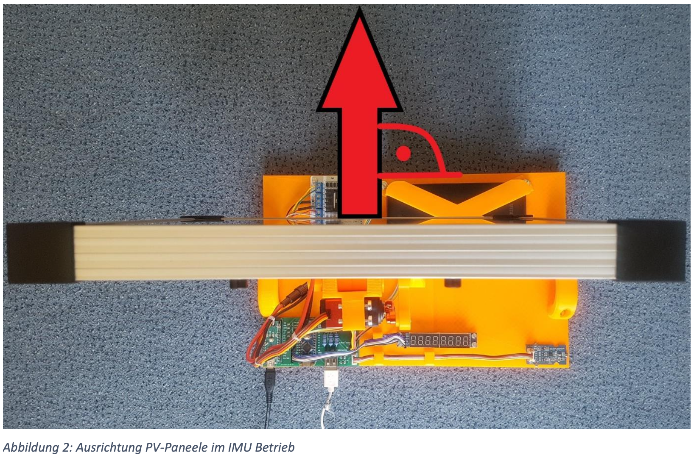

# How to operate (AutoFirmware)

For the tracker with **AutoFirmware** on the left Nano (`A_MATLAB`) and **MotorFirmware** on the right Nano.
The original way with MATLAB and `arduino()` is in [`../CurrentFirmware/HowToOperate.md`](../CurrentFirmware/HowToOperate.md); don't use it with this firmware (see MATLAB mode below).

## Two switches

| Switch | Where | Positions | What it does |
|---|---|---|---|
| Mode switch | left Nano, D2 | **AUTO** (open) / **MATLAB** (to GND) | Where the sun angle comes from: the Nano's own clock and sun calculation, or MATLAB over USB. Can be flipped while running. |
| IMU switch | PCB (`S_PROGRAMM`, right Nano D7) | **AN** / **AUS** | AUS: you point the panel South by hand. AN: at power-on the compass measures the direction once and the panel turns to South by itself. **Only change it with the power off.** |

Both combinations work: AUTO or MATLAB, each with IMU AN or AUS.

## Before every power-on: alignment

The right Nano has no home position. Wherever the mast stands at power-on is its start. So do the alignment **before every power-on**, also when the tracker was parked overnight.

### IMU AUS

1. Power OFF. IMU switch on **AUS**.
2. Set the panel upright using the servo linkage.
3. Turn the whole base so the panel faces **South**.
4. Keep the base level.

### IMU AN

1. Power OFF. IMU switch on **AN**.
2. Set the panel upright using the servo linkage.
3. Turn the panel into the **start pose of Figure 2** (page 2 of `Bedienungsanleitung.pdf`): the panel bar lies across the base arrow and the solar-cell face points **opposite** to the arrow.

   

4. Place the whole tracker so the panel faces **roughly South**. The exact direction doesn't matter, but not within about 50° of North (the cables can't reach South from there).
5. Keep the base level.
6. Keep magnets, metal and laptops at least 1 m away from the IMU. Best outdoors: indoors the building weakens the magnetic field and the panel can end up tens of degrees away from South. Outdoors it was within about ±2°.

## Start

1. Do the alignment for the IMU switch position.
2. Set the mode switch (AUTO or MATLAB).
3. Connect the charged power bank and turn the power ON.
4. Optional: connect the Mac by USB to the left Nano and watch the messages:
   ```bash
   cd AutoFirmware
   pio device monitor
   ```
   Opening the monitor restarts the left Nano, so the start sequence runs again. The right Nano keeps its position, so this is fine.
5. Right after the start the left Nano prints `IMU switch AN` or `IMU switch AUS`. It remembers this position until the next power-off.

### Start sequence with IMU AN (about 20 s, LED off)

**Don't touch the tracker during this.**

| Step | Time | What happens |
|---|---|---|
| Settle | 3 s | nothing moves |
| Measure | 10 s | the compass is read about 200 times and averaged |
| Turn | up to 20 s | the panel turns to South |
| Hold | 3 s | the panel stays at South |
| Running | – | normal AUTO or MATLAB mode |

The compass is read **only here**. Every sun angle afterwards is corrected with this one measurement. If the tracker is moved while running, power-cycle it and do the alignment again.

With IMU AUS there is no start sequence; tracking starts right away.

### AUTO mode

Nothing else to do. Every 30 s the Nano reads its clock, calculates the sun position and sends it to the right Nano. No computer needed.

The clock (DS1302) runs on **CET (winter time) all year**. Set it with `pio test -e nanosetup -f setup/test_rtc_set` (see [`test/README.md`](test/README.md)), only when the Mac is on winter time.

### MATLAB mode

1. Close the PlatformIO monitor (only one program can use the USB port).
2. Open `MatlabSerial/AusgabeSonnenstandSerial.m`, set `port` (find it with `serialportlist("available")`), click Run.
3. MATLAB sends the sun angle every 30 s. Stop with Ctrl+C, then type `clear s`.

**Never run the old `AusgabeSonnenstand.m` on this Nano.** Its `arduino()` call replaces AutoFirmware with MATLAB's own firmware.

You can also type angles by hand in the PlatformIO monitor: `azimuth elevation`, then Enter, e.g. `120 10`. Keep the elevation low while testing (the panel holder arm broke at 70° on 4 Nov 2026). With IMU AN, lines are ignored until the start sequence is done.

## What the tracker does

- **Night and unsafe angles:** if the sun is at or below the horizon, or the needed angle is outside 50°–310°, the panel parks upright:
  - IMU AUS: at the start direction (South, as you placed it).
  - IMU AN: at the South found in the start sequence.
- **Faults:** the panel parks upright at the start direction, the LED blinks fast and tracking stops until a power-cycle.

## LED (left Nano)

| LED | Meaning |
|---|---|
| Off | Start sequence (IMU AN) |
| Slow blink | AUTO, everything OK |
| Always on | MATLAB, everything OK |
| Fast blink | Fault. Read the message in the monitor (table below), then power-cycle. |

## Messages and what to do

"Power-cycle" means: power OFF **and** unplug the USB cable (USB also powers the left Nano), do the alignment, then start again.

| Message | Meaning | What to do |
|---|---|---|
| `Hybrid firmware, SEND_I2C = ON` | Left Nano started | – |
| `IMU switch AN` / `IMU switch AUS` | IMU switch read at the start | – |
| `START   hands off, measuring in 3 s` | Start sequence began (IMU AN) | Don't touch the tracker. |
| `START   measuring 10 s` | Compass is being read | – |
| `START   reads=...  h=...  panel=...  south=...  ack=0/0` | Result: `panel` = where the panel faced at power-on, `south` = where it turns to | – |
| `START   motor stopped -> hold 3 s` | Panel reached South | – |
| `START   done -> running` | Start sequence finished | – |
| `AUTO    <time>  az=...  el=...  ack=0/0` | IMU AUS: sun angle sent; `ack=0/0` = the right Nano got both bytes | – |
| `AUTO    <time>  sun=...  el=...  panel=...  az=...  ack=0/0` | IMU AN: sun angle (`sun`) and the corrected angle sent (`az`) | – |
| `... PARK` / `... PARK south` | Night or angle outside 50°–310° | – |
| `ack=` with numbers other than `0/0` | Right Nano did not get the bytes | Check the I2C wires between the Nanos. |
| `AUTO    RTC stopped / not valid / frozen -> nothing sent` | Clock problem, nothing sent | Check the RTC wires (D5, D6, D7); set the clock again. |
| `ignored: switch on AUTO` | A MATLAB line arrived in AUTO | Flip the mode switch to MATLAB. |
| `MATLAB  bad line -> ignored` | Line was not `azimuth elevation` | Check the format (dot, not comma). |
| `MATLAB  ignored: startup not finished` | Line came during the start sequence | Wait until `START   done -> running`. |
| `MATLAB  ignored: fault -> power-cycle` | Line came after a fault | Power-cycle. |
| `MATLAB  timeout -> panel stays` | No good line for 180 s | Restart the MATLAB script. The panel keeps its position. |
| `line too long -> ignored` | Serial line too long | Check what is sent. |
| `START   no good compass reads -> power-cycle` | The compass gave no usable reading | Check the IMU cable, power-cycle. |
| `START   panel faces north (panel=...), cables can't reach south -> ...` | Tracker was placed facing North | Turn the whole tracker around, power-cycle. |
| `START   turn not finished -> power-cycle` | The turn to South took longer than 20 s | Check the motor and the right Nano, power-cycle. |
| `right Nano not answering -> power-cycle` | Right Nano did not answer within 5 s of the start | Check the right Nano and the I2C wires, power-cycle. |
| `IMU switch moved -> power-cycle` | IMU switch changed while running | Do the alignment for the new position, power-cycle. |
| `FAULT   az=180.0000  el=0.0000 ... PARK` | Park after any fault | Read the message above it. |

## Stop

1. Turn the tracker's power OFF.
2. In MATLAB mode: Ctrl+C in MATLAB, then `clear s`.
3. Disconnect USB and the power bank if packing away.

The switches can stay where they are. Before the next power-on, do the alignment again.